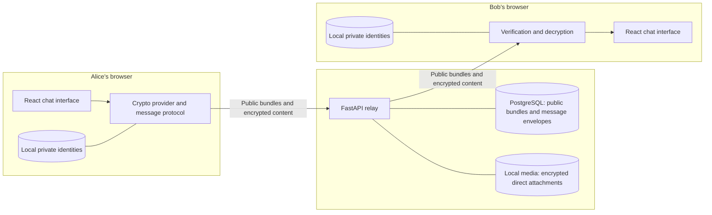

<div align="center">

# QuantX

### A chat application built to demonstrate the move from classical cryptography to post-quantum cryptography

**React · FastAPI · PostgreSQL · X25519 · ML-KEM · ML-DSA · AES-256-GCM**

[Getting started](#getting-started) · [Features](#features) · [Encryption modes](#encryption-modes) · [Migration demo](#demonstrating-the-migration) · [Documentation](#documentation)

</div>

---

## Overview

QuantX is a browser-based messaging project with direct conversations, groups, channels, file sharing, voice messages, and calling features. Its central learning objective is **cryptographic agility**: organizing cryptography so an application can adopt new algorithms while preserving most of its messaging interface and backend transport.

The project includes two working cryptographic suites for direct messages:

- **Classical:** X25519 for key establishment, Ed25519 for signatures, and AES-256-GCM for encryption.
- **Post-quantum:** ML-KEM-768 for key establishment, ML-DSA-65 for signatures, and AES-256-GCM for encryption.

Both suites use the same message protocol and application integration. After the one-time architectural preparation already implemented in this repository, changing a frontend configuration value selects the suite for new outgoing messages.

> **Project scope:** QuantX is an educational implementation of a classical-to-PQC migration. Direct messages and direct-chat attachments use browser-side end-to-end encryption. Group/channel posts, call media, signaling, and call logs are outside that E2EE implementation. The application is not an audited production messenger or a FIPS-validated product.

## Features

| Area | Included functionality |
| --- | --- |
| Accounts and profiles | Email/password registration and sign-in, profile details, profile images, and online-status indicators |
| Direct messaging | Text conversations, replies, forwarding, message editing, deletion, and delivery/read indicators |
| Media sharing | Images, videos, files, audio attachments, and recorded voice messages |
| Community conversations | Group creation, member/admin management, channel creation, and channel follow/unfollow |
| Calling | Browser calling interface, WebRTC media, signaling, and call history |
| Interface | Responsive chat layout, conversation sidebar, themes, message actions, and media previews |
| Encryption | Selectable classical/PQC suites, signed public-key bundles, signed message envelopes, and AES-256-GCM |
| Contact verification | Shared safety numbers, contact-key pinning, and explicit trust confirmation when identities change |
| Developer tooling | Crypto regression tests, frontend tests, backend contract tests, optional PostgreSQL integration, and local benchmarks |

Encryption coverage is narrower than the overall feature set:

| Data | Handling in the current implementation |
| --- | --- |
| Direct-message text, replies, and attachment metadata | Encrypted in the browser before submission |
| Direct-chat attachment bytes | Encrypted before upload; decrypted locally for viewing |
| Direct-message edits | A complete replacement encrypted envelope; edited plaintext is not submitted |
| Group/channel posts and their attachments | Outside the direct-message E2EE protocol |
| Call media, signaling, and call logs | Separate calling transport; not protected by the selectable message suite |
| User profiles, public keys, participant identifiers, timestamps, and traffic metadata | Not hidden by message encryption |

## Technology stack

| Layer | Technology and responsibility |
| --- | --- |
| Web interface | React 19, Create React App, JavaScript, and CSS |
| Classical cryptography | Browser Web Crypto API: X25519, Ed25519, HKDF-SHA256, and AES-GCM |
| PQC implementation | `@noble/post-quantum`: ML-KEM-768 and ML-DSA-65 |
| Private identity persistence | Browser IndexedDB |
| Active backend | Python, FastAPI, Uvicorn, and Pydantic |
| Database | PostgreSQL with `psycopg2`; JSONB message bodies |
| Account security | Argon2 password hashing and JWT bearer tokens |
| Media storage | Local filesystem storage served through the Python backend |
| Calling | Browser media APIs and WebRTC |
| Verification | Native Node tests, Jest/React Testing Library, Python `unittest`, and PostgreSQL integration tests |

The only application backend is the FastAPI/PostgreSQL service in **`py_backend/`**.

## System architecture



The browser performs message cryptography. The Python backend authenticates requests, validates the public envelope format and participants, distributes public identities, and stores encrypted content.

Private identities are not uploaded. Contact trust decisions and the keys needed to read message history remain in the browser that created them.

## Encryption modes

| Purpose | `classical` | `pqc` |
| --- | --- | --- |
| Key establishment | X25519 | ML-KEM-768 |
| Bundle and message signatures | Ed25519 | ML-DSA-65 |
| Wrapping-key derivation | HKDF-SHA256 | HKDF-SHA256 |
| Message encryption | AES-256-GCM | AES-256-GCM |
| Direct attachment encryption | AES-256-GCM | AES-256-GCM |
| Message protocol | Version 2.0 | Version 2.0 |

**ML-KEM** is the standardized successor derived from Kyber. It establishes shared secrets; it does not directly encrypt the chat text. **ML-DSA**, derived from Dilithium, produces digital signatures. **AES-256-GCM** encrypts the message content and remains in both modes.

### How a direct message is protected

1. **Create identities.** On sign-in, the browser creates or loads separate encryption and signing identities for both suites. It registers signed public bundles with the backend.
2. **Verify the contact.** The sender fetches the selected suite's recipient bundle, verifies its signature, and checks its fingerprint against the local trust pin.
3. **Generate a message key.** A fresh random 256-bit AES key is created for each message.
4. **Protect that key.** The chosen provider establishes a secret for each participant. HKDF derives wrapping keys, and AES-GCM wraps the message key for both the recipient and the sender's history.
5. **Encrypt and sign.** AES-GCM encrypts the complete message payload. Authenticated metadata binds the thread, participants, devices, suite, and message ID. The sender signs the envelope.
6. **Relay the envelope.** The backend stores the encrypted message and records its identifier to reject duplicate submissions.
7. **Verify and decrypt locally.** The receiving browser verifies the sender and envelope, unwraps the message key, and decrypts the content.

Direct attachments use their own random AES keys. Their ciphertext is uploaded under an opaque filename; the decryption descriptor and original file metadata travel inside the encrypted message.

The provider contract, key handling, trust model, setup, and validation commands are all documented in this README.

## Repository structure

```text
MyChatApp/
├── frontend/
│   ├── public/                         Static application assets
│   ├── src/
│   │   ├── components/
│   │   │   ├── chatwindow/             Messages, composer, calls, voice, and previews
│   │   │   └── community/              Group and channel interfaces
│   │   ├── crypto/
│   │   │   ├── providers/              Classical and post-quantum implementations
│   │   │   ├── primitives/             Encoding, HKDF, and AES-GCM helpers
│   │   │   ├── protocol/               Message and attachment encryption
│   │   │   ├── storage/                IndexedDB identity and trust storage
│   │   │   └── suites.js               Provider registry and mode selection
│   │   ├── pages/                      Public landing page and authentication
│   │   ├── services/                   API, auth, chat, community, media, and E2EE facade
│   │   ├── styles/                     Shared interface styles
│   │   └── App.js                      Application composition
│   ├── tests/crypto/                   Crypto regression tests and benchmarks
│   └── .env.example                    Frontend configuration template
├── py_backend/
│   ├── app/
│   │   ├── routes/                     Auth, chat, public keys, users, threads, and media
│   │   ├── schemas/                    Strict encrypted-envelope contracts
│   │   ├── security/                   Passwords, JWTs, and request authentication
│   │   ├── db.py                       Connections, queries, and schema initialization
│   │   ├── schema.sql                  PostgreSQL schema and additive crypto tables
│   │   └── main.py                     FastAPI application
│   ├── tests/                          Contract and optional database integration tests
│   ├── local_media/                    Runtime media files
│   └── requirements.txt                Runtime and test dependencies
├── package.json                        npm workspace and application scripts
└── README.md
```

The active E2EE implementation is in **`frontend/src/crypto/`**. Changing the Python classical reference examples does not change browser message encryption.

## Getting started

### 1. Prerequisites

Install these tools before starting:

- **Node.js 20.19+** and npm; Node 24 was used for the recorded validation.
- **Python 3.10+** with virtual-environment support.
- **PostgreSQL**, with a database role that can initialize the schema and the `uuid-ossp` extension.
- A modern browser supporting IndexedDB and Web Crypto's X25519/Ed25519 algorithms.

The commands below use a POSIX shell and start from the repository root. Browser cryptography and microphone/camera access require a secure context: use `localhost` for development or HTTPS when hosted.

### 2. Install dependencies

```bash
# From the repository root
npm ci

python3 -m venv .venv
. .venv/bin/activate
python -m pip install -r py_backend/requirements.txt
```

An existing working Python virtual environment can also be used.

### 3. Configure the environment

For a fresh checkout, create local configuration files from the supplied templates. Keep existing `.env` files if you have already configured the project.

```bash
cp frontend/.env.example frontend/.env
cp py_backend/.env.example py_backend/.env
```

Set the frontend API address and initial encryption mode in `frontend/.env`:

```dotenv
# Empty in development: React proxies /api to py_backend on port 4000.
REACT_APP_API_BASE_URL=
REACT_APP_CRYPTO_SUITE=pqc
```

Configure the Python backend in `py_backend/.env`:

```dotenv
PORT=4000
CORS_ORIGINS=http://localhost:3000

POSTGRES_HOST=localhost
POSTGRES_PORT=5432
POSTGRES_DB=quantx_db
POSTGRES_USER=postgres
POSTGRES_PASSWORD=replace-with-your-local-password

JWT_SECRET=replace-with-a-random-secret-of-at-least-32-characters
JWT_TTL_MINUTES=60

LOCAL_MEDIA_ROOT=./local_media
POSTGRES_POOL_MIN=1
POSTGRES_POOL_MAX=12
```

Generate a random JWT secret and replace the placeholder above:

```bash
python -c "import secrets; print(secrets.token_urlsafe(48))"
```

`JWT_SECRET` belongs only in the backend environment. Variables beginning with `REACT_APP_` are embedded in the frontend build and are public.

| Setting | Purpose |
| --- | --- |
| `REACT_APP_API_BASE_URL` | API origin used by the browser |
| `REACT_APP_CRYPTO_SUITE` | Suite for new outgoing direct messages: `classical` or `pqc` |
| `DATABASE_URL` | Optional PostgreSQL connection string; takes precedence over `POSTGRES_*` |
| `POSTGRES_*` | Database connection settings when `DATABASE_URL` is absent |
| `JWT_SECRET` | Random backend-only secret for signing and checking access tokens |
| `JWT_TTL_MINUTES` | Access-token lifetime; users sign in again when their session expires |
| `CORS_ORIGINS` | Comma-separated allowed frontend origins |
| `LOCAL_MEDIA_ROOT` | Filesystem location for uploaded media; relative paths use the backend's working directory |
| `E2EE_REQUIRED` | Keep `true` so direct messages always use the frontend-selected E2EE suite |

Existing process environment variables take precedence. The Python loader then checks `py_backend/.env`, root `.env`, and `frontend/.env` without overwriting values already set. Keep backend settings in `py_backend/.env`.

### 4. Create the database

With PostgreSQL running, create the database named in your configuration. For the example configuration:

```bash
createdb -h localhost -U postgres quantx_db
```

Skip creation if the database already exists. On backend startup, the application creates missing tables and applies its additive compatibility migrations. The crypto tables store public identity bundles and durable message receipts. Existing messages are not automatically deleted.

### 5. Start the Python backend

In the first terminal, from the repository root:

```bash
. .venv/bin/activate
cd py_backend
python -m uvicorn app.main:app --host 127.0.0.1 --port 4000 --reload
```

Alternatively, use the repository launcher from the root:

```bash
npm run backend
```

The launcher checks Python dependencies and PostgreSQL before starting FastAPI.
Keep port 4000 consistent with the frontend API URL.

### 6. Start the frontend

In a second terminal, from the repository root:

```bash
npm run frontend
```

Run the backend and frontend in separate terminals for clearer logs. `npm run dev`
is only a convenience command that starts both processes together.

| Address | Purpose |
| --- | --- |
| [localhost:3000](http://localhost:3000) | React application |
| [localhost:4000/docs](http://localhost:4000/docs) | Interactive FastAPI endpoint documentation |
| [localhost:4000/api/health](http://localhost:4000/api/health) | Backend health |
| [localhost:4000/api/health/db](http://localhost:4000/api/health/db) | Database connectivity check |

Register two users in separate browser profiles to try a direct conversation. Both users must sign in with the updated application so their public identities are registered.

## Demonstrating the migration

### Use post-quantum cryptography (default)

The checked-in example and local development configuration default to:

```dotenv
REACT_APP_CRYPTO_SUITE=pqc
```

Start the frontend explicitly in PQC mode with `npm run start:pqc`, or create a
production PQC build with `npm run build:pqc`. Use `npm run dev:pqc` to start
both the Python backend and PQC frontend together. Plain `npm run dev` also
selects PQC.

### Switch to classical cryptography

Set this value in `frontend/.env`:

```dotenv
REACT_APP_CRYPTO_SUITE=classical
```

Restart the frontend. Sign in as Alice and Bob using separate browser profiles, open a direct conversation, and send messages. The message labels show **Classical**.

Use `npm run dev:classical` to start the Python backend and classical frontend
together, or `npm run build:classical` for a production build.

Try a reply, an attachment, and an edit. Reload both browsers to demonstrate that each participant can still read their history.

### Switch new messages back to PQC

Change the same value:

```dotenv
REACT_APP_CRYPTO_SUITE=pqc
```

Restart the React development server and reload the clients. For a deployed frontend, rebuild and deploy the new build instead.

New outgoing direct messages now use **ML-KEM-768 + ML-DSA-65 + AES-256-GCM**, and their labels show **PQC**. No backend suite toggle or algorithm-code edit is required for this demonstration.

| Changes when switching modes | Remains shared |
| --- | --- |
| Key-establishment provider | React chat interface |
| Signature provider | Message orchestration and transport |
| Selected local identities and contact trust pins | AES-256-GCM and HKDF-SHA256 |
| Authenticated suite metadata | Backend ciphertext storage and API structure |

Both identities are prepared on sign-in. Upgraded clients can receive either suite, and protocol-v2 classical history remains readable after switching. Keep browser storage intact.

**A switch applies to new sends.** It does not re-encrypt old messages, upgrade the confidentiality of previously captured classical ciphertext, or require every incoming message to use PQC. Unknown suite identifiers fail rather than silently falling back.

The project demonstrates a configuration-level migration **after** the shared abstractions and versioned protocol have been implemented. That preparation is what makes the later switch small.

## Contact verification and local identities

Open **Safety number** from a direct conversation's menu. Compare the displayed value with the contact through a separate trusted channel, and confirm trust only when both values match.

The application uses **trust on first use**. A self-signed public bundle verifies consistency, but by itself cannot prove who supplied the first key. Once a contact is pinned, changed identities block sending until explicitly verified.

Each user currently has one active browser identity per suite. Signing in on another browser can replace the registry entry and trigger an identity-change check. Private keys are not synchronized to that browser. Clearing IndexedDB loses the local keys required to read history.

## Backend API and persistence

FastAPI exposes these route groups:

| Route prefix | Responsibility |
| --- | --- |
| `/api/auth` | Account registration, sign-in, and profile updates |
| `/api/users` | User and profile-related operations |
| `/api/thread` | Conversation, user, group, and channel listings |
| `/api/chat` | Message operations, conversation metadata, calls, and signaling |
| `/api/community` | Group and channel management |
| `/api/media` | Media upload and retrieval |
| `/api/keys/v2` | Authenticated public encryption-identity registration and lookup |
| Legacy `/api/keys` endpoints | Retired protocol-v1 endpoints return HTTP 410 |

PostgreSQL stores application records, encrypted direct-message envelopes, public bundles, and message receipts. Local media storage holds uploads; direct attachments arrive as ciphertext, while other upload categories are outside the E2EE scope.

The new direct-message paths enforce bearer identity and envelope-context checks. Other legacy application routes have not all received an equivalent authorization audit.

Use the running backend's [`/docs`](http://localhost:4000/docs) page for endpoint parameters and request/response schemas.

## Tests and benchmarks

### Run the automated checks

From the repository root:

```bash
# Cryptography and attachment tests
npm run test:crypto --workspace frontend

# React and chat-service tests
CI=true npm test --workspace frontend -- --watchAll=false --runInBand

# Production frontend build
npm run build --workspace frontend

# Backend tests, with Python test dependencies installed
PYTHONPATH=py_backend python -m unittest discover -s py_backend/tests -v
```

The backend suite skips its PostgreSQL integration test unless a disposable database is configured through `TEST_DATABASE_URL`.

The recorded validation contains **31 passing tests**:

| Suite | Tests | Coverage |
| --- | ---: | --- |
| Native crypto and attachments | 14 | Both suites, history, tampering, identity changes, safety numbers, migration, and binary attachments |
| React and services | 6 | Landing-page navigation, encrypted sends/edits, content handling, and failure behavior |
| Backend contracts | 10 | Authentication, public-only registration, schema validation, context, edits, and replay rejection |
| Real PostgreSQL integration | 1 | Idempotent migrations, registration, encrypted persistence, edits, and durable receipt checks |

The production builds for both crypto modes compile successfully. A complete two-browser UI session is not automated.

### Compare the suites

```bash
npm run benchmark:crypto --workspace frontend
```

The benchmark reports key sizes, signature sizes, envelope size, and local timings. Example output:

| Metric | Classical | PQC |
| --- | ---: | ---: |
| Encryption public key | 32 bytes | 1,184 bytes |
| Signing public key | 32 bytes | 1,952 bytes |
| Message signature | 64 bytes | 3,309 bytes |
| Example JSON envelope | 3,425 bytes | 33,955 bytes |
| Mean message encryption | 11.49 ms | 43.61 ms |
| Mean message decryption | 7.14 ms | 25.30 ms |

These are sample Node measurements with an in-memory relay, not browser/network performance guarantees. Envelopes are intentionally self-contained and include repeated authentication metadata, which adds overhead.

## Security boundaries and current limitations

- **Educational protocol:** the application has not undergone a full cryptographic or production security audit. Using standardized algorithms does not certify the complete system.
- **Direct-message scope:** group/channel posts, calling transport, profiles, and traffic metadata are outside the selectable E2EE suite.
- **Local device trust:** IndexedDB keeps private material off the server, but does not protect it from malicious same-origin JavaScript, XSS, or a compromised browser/OS.
- **History and device recovery:** there is no automatic private-key backup or multi-device synchronization. Preserve the original browser storage to retain access to its messages.
- **No ratchet guarantees:** the envelope design does not claim Double Ratchet forward secrecy or post-compromise recovery. Long-lived identity compromise can expose captured history for that identity.
- **Migration compatibility:** protocol-v2 classical and PQC history can coexist. The insecure protocol-v1 implementation is retired, and new clients refuse to decrypt those legacy messages. Historical rows remain stored; treat their old keys and contents as compromised.
- **Calling and hosting:** microphone/camera permissions and WebRTC connectivity depend on the browser and network. Successful localhost tests do not establish internet-wide calling reliability.

These boundaries are part of the project explanation and should remain visible when presenting or extending the application.

## Troubleshooting

| Symptom | What to check |
| --- | --- |
| Frontend cannot reach the API | Confirm the Python backend is running on port 4000, then check `REACT_APP_API_BASE_URL` and `CORS_ORIGINS`. |
| Database connection fails | Check PostgreSQL is running, the configured database exists, and `DATABASE_URL` or `POSTGRES_*` matches your local setup. |
| Schema initialization fails | Verify the database role can create the required objects, including the `uuid-ossp` extension. |
| Backend asks for `JWT_SECRET` | Replace the example placeholder with a random secret of at least 32 characters. |
| Session expired | Sign in again to obtain a fresh access token. |
| Contact has no compatible identity | Ask the contact to sign in with the updated frontend against the Python backend. |
| A contact's identity changed | Compare safety numbers through a trusted channel and explicitly trust the verified replacement. |
| Mode still shows Classical | Restart/rebuild the frontend after changing `.env`; also check for a `REACT_APP_CRYPTO_SUITE` override in `.env.local` or the process environment. |
| Old messages cannot decrypt | Check that you are using the original browser profile. Retired v1 messages and messages for another device are not recoverable through the new protocol. |
| Browser crypto or microphone access fails | Use localhost or HTTPS and verify browser algorithm support and permissions. |

## Project team

As credited in the application:

**M. Marjan Ghazi · M. Mudassir · Faiq Riaz**

National University of Modern Languages, Islamabad

Supervised by **Faisal Hussain**

## References

- [NIST FIPS 203 — ML-KEM](https://csrc.nist.gov/pubs/fips/203/final)
- [NIST FIPS 204 — ML-DSA](https://csrc.nist.gov/pubs/fips/204/final)
- [NIST post-quantum cryptography FAQ](https://csrc.nist.gov/Projects/Post-Quantum-Cryptography/faqs)
- [noble-post-quantum implementation](https://github.com/paulmillr/noble-post-quantum)
