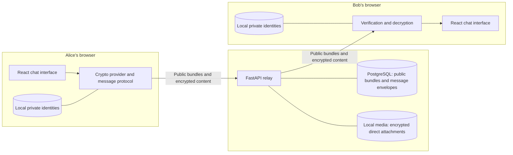

<div align="center">

# QuantX

### Post-quantum direct messaging and live cryptography demonstration

**React · FastAPI · PostgreSQL · ML-KEM-768 · ML-DSA-65 · AES-256-GCM**

[Getting started](#getting-started) · [Features](#features) · [PQC protocol](#pqc-protocol) · [Word handbook](QUANTX_Project_Handbook.docx) · [Frontend-to-database guide](docs/PROJECT_DATA_FLOW.md) · [Jury walkthrough](#jury-walkthrough) · [Troubleshooting](#troubleshooting)

</div>

---

## Overview

QuantX is a browser-based messaging project with direct conversations, groups, channels, file sharing, voice messages, and calling features. Its direct-message protocol uses **ML-KEM-768**, **ML-DSA-65**, **HKDF-SHA256**, and **AES-256-GCM**. ML-KEM is standardized from Kyber; ML-DSA is standardized from Dilithium. AES-GCM is the symmetric content cipher.

Only the PQC suite is active in the frontend and accepted by the API. The former X25519/Ed25519 provider remains commented in `frontend/src/crypto/providers/classical.js` as requested. Existing classical database rows are preserved, but the PQC-only client cannot decrypt that history.

> **Project scope:** Direct messages and direct-chat attachments use browser-side end-to-end encryption. Group/channel posts, call media, signaling, and call logs are outside that E2EE implementation. QuantX is an educational prototype, not an audited production messenger or FIPS-validated product.

## Features

| Area | Included functionality |
| --- | --- |
| Accounts and profiles | Email/password registration and sign-in, profile details, profile images, and online-status indicators |
| Direct messaging | Text conversations, replies, forwarding, message editing, deletion, and delivery/read indicators |
| Media sharing | Images, videos, files, audio attachments, and recorded voice messages |
| Community conversations | Group creation, member/admin management, channel creation, and channel follow/unfollow |
| Calling | Browser calling interface, WebRTC media, signaling, and call history |
| Interface | Responsive chat layout, conversation sidebar, themes, message actions, and media previews |
| Encryption | PQC-only signed public-key bundles, signed message envelopes, and AES-256-GCM |
| Contact verification | Shared safety numbers, contact-key pinning, and explicit trust confirmation when identities change |
| Presentation demo | Interactive protocol walkthrough and per-message encryption details |

Encryption coverage is narrower than the overall feature set:

| Data | Handling in the current implementation |
| --- | --- |
| Direct-message text, replies, and attachment metadata | Encrypted in the browser before submission |
| Direct-chat attachment bytes | Encrypted before upload; decrypted locally for viewing |
| Direct-message edits | A complete replacement encrypted envelope; edited plaintext is not submitted |
| Group/channel posts and their attachments | Outside the direct-message E2EE protocol |
| Call media, signaling, and call logs | Separate calling transport; outside direct-message E2EE |
| User profiles, public keys, participant identifiers, timestamps, and traffic metadata | Not hidden by message encryption |

## Technology stack

| Layer | Technology and responsibility |
| --- | --- |
| Web interface | React 19, Create React App, JavaScript, and CSS |
| Symmetric cryptography | Browser Web Crypto API: HKDF-SHA256 and AES-GCM |
| PQC implementation | `@noble/post-quantum`: ML-KEM-768 and ML-DSA-65 |
| Private identity persistence | Browser IndexedDB |
| Active backend | Python, FastAPI, Uvicorn, and Pydantic |
| Database | PostgreSQL with `psycopg2`; JSONB message bodies |
| Account security | Argon2 password hashing and JWT bearer tokens |
| Media storage | Local filesystem storage served through the Python backend |
| Calling | Browser media APIs and WebRTC |
| Presentation | Browser-based cryptography walkthrough and envelope inspection |

The only application backend is the FastAPI/PostgreSQL service in **`py_backend/`**.

## System architecture



The browser performs message cryptography. The Python backend authenticates requests, validates the public envelope format and participants, distributes public identities, and stores encrypted content.

Private identities are not uploaded. Contact trust decisions and the keys needed to read message history remain in the browser that created them.

## PQC protocol

| Purpose | Active algorithm |
| --- | --- |
| Key encapsulation | ML-KEM-768 |
| Bundle and message signatures | ML-DSA-65 |
| Wrapping-key derivation | HKDF-SHA256 |
| Message and direct-attachment encryption | AES-256-GCM |
| Direct-message protocol | Version 2.0, suite `pqc` |

ML-KEM establishes shared secrets; it does not directly encrypt chat text. AES-256-GCM encrypts content and wraps the random content key. ML-DSA signs identity bundles and message envelopes.

### How a direct message is protected

1. **Create identities.** On sign-in, the browser creates or loads ML-KEM and ML-DSA keys. It registers a signed PQC public bundle with the backend.
2. **Verify the contact.** The sender fetches the recipient's PQC bundle, verifies its signature, and checks its fingerprint against the local trust pin.
3. **Generate a message key.** A fresh random 256-bit AES key is created for each message.
4. **Protect that key.** ML-KEM encapsulates a secret for each participant. HKDF derives wrapping keys, and AES-GCM wraps the message key for both the recipient and the sender's history.
5. **Encrypt and sign.** AES-GCM encrypts the complete message payload. Authenticated metadata binds the thread, participants, devices, suite, and message ID. The sender signs the envelope.
6. **Relay the envelope.** The backend stores the encrypted message and records its identifier to reject duplicate submissions.
7. **Verify and decrypt locally.** The receiving browser verifies the sender and envelope, unwraps the message key, and decrypts the content.

Direct attachments use their own random AES keys. Their ciphertext is uploaded under an opaque filename; the decryption descriptor and original file metadata travel inside the encrypted message.

The activity popup shows algorithm progress on registration, direct-message send and receive, and direct-attachment upload. It never displays secret material.

## Repository structure

```text
MyChatApp/
├── frontend/
│   ├── public/                         Static application assets
│   ├── src/
│   │   ├── components/
│   │   │   ├── chatwindow/             Messages, composer, calls, voice, and previews
│   │   │   ├── community/              Group and channel interfaces
│   │   │   └── crypto/                 Live protocol demonstration
│   │   ├── crypto/
│   │   │   ├── demo/                   Isolated in-memory protocol walkthrough
│   │   │   ├── providers/              Active PQC and commented historical provider
│   │   │   ├── primitives/             Encoding, HKDF, and AES-GCM helpers
│   │   │   ├── protocol/               Message and attachment encryption
│   │   │   ├── storage/                IndexedDB identity and trust storage
│   │   │   └── suites.js               PQC-only provider registry
│   │   ├── pages/                      Public landing page and authentication
│   │   ├── services/                   API, auth, chat, community, media, and E2EE facade
│   │   └── App.js                      Application composition
│   └── .env.example                    Frontend configuration template
├── py_backend/
│   ├── app/
│   │   ├── routes/                     Auth, chat, public keys, users, threads, and media
│   │   ├── schemas/                    Strict encrypted-envelope contracts
│   │   ├── security/                   Passwords, JWTs, and request authentication
│   │   ├── db.py                       Connections, queries, and schema initialization
│   │   ├── schema.sql                  PostgreSQL schema and additive crypto tables
│   │   └── main.py                     FastAPI application
│   ├── local_media/                    Runtime media files
│   └── requirements.txt                Backend runtime dependencies
├── package.json                        npm workspace and application scripts
└── README.md
```

The active E2EE implementation is in **`frontend/src/crypto/`**. The Python backend validates and relays encrypted envelopes; browser providers perform the cryptographic operations.

## Jury walkthrough

1. Start the frontend and open the landing page. Choose **See Live Crypto Demo**. It runs without an account, backend, or database.
2. Enter a sample message and run the live PQC demonstration. It uses the real direct-message protocol with temporary Alice and Bob identities. Show the key and envelope sizes, timings, ciphertext excerpt, and tamper rejection. Timings vary by machine.
3. Sign in as two users in separate browser profiles. Point out the identity-setup popup, send a direct message, then show the encryption popup and **PQC** label. On the other browser, show the verification/decryption popup. Open **View encryption** on a message to inspect the authenticated envelope.
4. Send an attachment to show browser-side AES-GCM encryption. Open **Safety number** in the chat menu to explain contact identity verification.

The lab creates PQC identities only. All demo keys and messages stay in page memory and do not go to FastAPI. The supported PQC parameter sets are **ML-KEM-768** and **ML-DSA-65**; AES-256-GCM is a symmetric cipher.

## Getting started

### 1. Prerequisites

Install these tools before starting:

- **Node.js 20.19+** and npm; Node 24 was used for the recorded validation.
- **Python 3.10+** with virtual-environment support.
- **PostgreSQL**, with a database role that can initialize the schema and the `uuid-ossp` extension.
- A modern browser supporting IndexedDB and Web Crypto's AES-GCM and HKDF algorithms.

The commands below use a POSIX shell and start from the repository root. Browser cryptography and microphone/camera access require a secure context: use `localhost` for development or HTTPS when hosted.

### 2. Install dependencies

```bash
# From the repository root
npm ci

python3 -m venv .venv
. .venv/bin/activate
python -m pip install -r py_backend/requirements.txt
```

An existing working Python virtual environment can also be used.

### 3. Configure the environment

For a fresh checkout, create local configuration files from the supplied templates. Keep existing `.env` files if you have already configured the project.

```bash
cp frontend/.env.example frontend/.env
cp py_backend/.env.example py_backend/.env
```

Set the frontend API address in `frontend/.env`:

```dotenv
# Empty in development: React proxies /api to py_backend on port 4000.
REACT_APP_API_BASE_URL=
```

Configure the Python backend in `py_backend/.env`:

```dotenv
PORT=4000
CORS_ORIGINS=http://localhost:3000

POSTGRES_HOST=localhost
POSTGRES_PORT=5432
POSTGRES_DB=quantx_db
POSTGRES_USER=postgres
POSTGRES_PASSWORD=replace-with-your-local-password

JWT_SECRET=replace-with-a-random-secret-of-at-least-32-characters
JWT_TTL_MINUTES=60

ADMIN_EMAIL=admin@gmail.com
ADMIN_PASSWORD=admin123

LOCAL_MEDIA_ROOT=./local_media
POSTGRES_POOL_MIN=1
POSTGRES_POOL_MAX=12
```

Generate a random JWT secret and replace the placeholder above:

```bash
python -c "import secrets; print(secrets.token_urlsafe(48))"
```

`JWT_SECRET` belongs only in the backend environment. Variables beginning with `REACT_APP_` are embedded in the frontend build and are public.

| Setting | Purpose |
| --- | --- |
| `REACT_APP_API_BASE_URL` | API origin used by the browser |
| `DATABASE_URL` | Optional PostgreSQL connection string; takes precedence over `POSTGRES_*` |
| `POSTGRES_*` | Database connection settings when `DATABASE_URL` is absent |
| `JWT_SECRET` | Random backend-only secret for signing and checking access tokens |
| `JWT_TTL_MINUTES` | Access-token lifetime; users sign in again when their session expires |
| `ADMIN_EMAIL` and `ADMIN_PASSWORD` | Backend-only credentials for the `/admin` user directory |
| `CORS_ORIGINS` | Comma-separated allowed frontend origins |
| `LOCAL_MEDIA_ROOT` | Filesystem location for uploaded media; relative paths use the backend's working directory |
| `E2EE_REQUIRED` | Keep `true` so direct messages require E2EE |

Existing process environment variables take precedence. The Python loader then checks `py_backend/.env`, root `.env`, and `frontend/.env` without overwriting values already set. Keep backend settings in `py_backend/.env`.

Open `/admin` in the frontend and sign in with `admin@gmail.com` / `admin123` to view registered users. The directory shows stored profile, contact, and activity fields. Admins can edit a user's display name, email, and phone number; email and phone uniqueness is enforced. Password hashes and chat plaintext are never returned. Change `ADMIN_PASSWORD` before exposing the app publicly.

Each account now needs a unique email and phone number. New registrations save both immediately. Existing accounts can open **Profile → Your phone number** to save their number; users can then add that number as a contact. Pakistan mobile numbers entered as `03...`, `3...`, or `+923...` resolve to the same account. Numbers listed under **Contacts** on the admin page belong to the viewer's address book; they do not identify that account's own phone number.

The admin **PQC and logins** module labels the three active algorithms: Kyber (ML-KEM-768) public encryption keys and encapsulations, Dilithium (ML-DSA-65) public signing keys and signatures, and AES-256-GCM ciphertext, nonces, and wrapped content keys. It reads the existing encrypted direct-message envelopes and shows authentication events recorded after this update. The server does not hold raw AES content keys, private E2EE keys, or message plaintext. Login uses Argon2id password hashes and HS256 JWTs, not PQC; no passwords, hashes, or tokens appear in the module.

The admin **How it works · Live demo** module explains registration, sign-in, public identity registration, ML-KEM encapsulation, AES-GCM encryption, ML-DSA signing, and recipient verification/decryption. Select **Next new registration** before creating an account, or select an existing user before signing in or sending a direct message, then click **Start live demo**. To show the complete message journey, select **Two-user direct message**, choose sender and recipient accounts, start capture, and send a new direct message between their signed-in browsers. The module polls every 1.5 seconds for real browser stages, per-stage times, total flow times, and numeric key/envelope sizes; it also shows the complete public keys and actual ciphertext stored by the relay. Capture lasts ten minutes and can be stopped. Existing browser keys are reused at sign-in, so key-generation time appears only when new keys are created. Registration and login timings include the account API round trip and are separate from PQC timings. Measurements depend on device and network; the view reports observed medians but does not claim a PQC-versus-classical benchmark. Activity events contain only stage names, timings, and byte counts; private keys, passwords, tokens, message contents, and raw AES keys are never reported to the admin. The separate public-site cryptography lab still runs an isolated demonstration with temporary identities.

At the top of that module, **How does a private message travel?** is a seven-step illustrated walkthrough with Play, Pause, Previous, Next, Replay, and direct step selection. It explains Alice's readable message, Bob's public key, Kyber/HKDF key wrapping, AES encryption, Dilithium signing, server relay, and Bob's verification and decryption. Its example text is illustrative; use the live demo below it to inspect real browser activity. The **Why QUANTX uses PQC** section explains the future quantum threat and the “harvest now, decrypt later” risk, then compares RSA/ECDH and RSA/ECDSA roles with ML-KEM and ML-DSA while showing that AES-256-GCM still encrypts the message body. The page links to [NIST's ML-KEM standard](https://csrc.nist.gov/pubs/fips/203/final), [ML-DSA standard](https://csrc.nist.gov/pubs/fips/204/final), and [PQC explainer](https://www.nist.gov/cybersecurity-and-privacy/what-post-quantum-cryptography).

Each signed-in user can open **Profile → Your encryption keys** to reveal the complete ML-KEM-768 and ML-DSA-65 public and secret keys stored in that browser's IndexedDB database (`quantx-crypto-v2`, `secrets` store, `identity:<uid>:pqc` entry). The optional **Message key walkthrough** captures one real direct-message operation for ten minutes. It shows the temporary Kyber shared secret, HKDF wrapping key, AES content key, wrapped key, nonce, ciphertext, and Dilithium signature, with an animated path. This extra copy exists only in the current tab's memory and is cleared on Stop, sign-out, reload, or expiry. The admin live view animates the relay path and displays full public keys and the actual stored encrypted packet; it never receives raw secret keys.

### 4. Create the database

On Debian or Ubuntu, start PostgreSQL and confirm it accepts connections:

```bash
sudo systemctl start postgresql
pg_isready -h localhost -p 5432
```

On the PostgreSQL 18 cluster shown in your local logs, `sudo pg_ctlcluster 18 main start` also starts the database.

Create the database named in your configuration. For the example configuration:

```bash
createdb -h localhost -U postgres quantx_db
```

Skip creation if the database already exists. On backend startup, the application creates missing tables and applies its additive compatibility migrations. The crypto tables store public identity bundles and durable message receipts. Existing messages are not automatically deleted.

### 5. Start the Python backend

In the first terminal, from the repository root:

```bash
. .venv/bin/activate
cd py_backend
python -m uvicorn app.main:app --host 127.0.0.1 --port 4000 --reload
```

Alternatively, use the repository launcher from the root:

```bash
npm run backend
```

The launcher checks Python dependencies and PostgreSQL before starting FastAPI.
Keep port 4000 consistent with the frontend API URL.

### 6. Start the frontend

In a second terminal, from the repository root:

```bash
npm run frontend
```

Run the backend and frontend in separate terminals for clearer logs. `npm run dev`
is only a convenience command that starts both processes together.

| Address | Purpose |
| --- | --- |
| [localhost:3000](http://localhost:3000) | React application |
| [localhost:4000/docs](http://localhost:4000/docs) | Interactive FastAPI endpoint documentation |
| [localhost:4000/api/health](http://localhost:4000/api/health) | Backend health |
| [localhost:4000/api/health/db](http://localhost:4000/api/health/db) | Database connectivity check |

Register two users in separate browser profiles to try a direct conversation. Both users must sign in with the updated application so their public identities are registered.

## Live PQC demonstration

Run `npm run dev` to start the backend and frontend together, or use separate terminals as above. `npm run start:pqc` starts the frontend alone; `npm run build:pqc` creates a production build. The active suite is fixed to `pqc`, even if an old local environment file still contains `REACT_APP_CRYPTO_SUITE=classical`.

Open **Live demo** on the landing page for a local Alice-to-Bob round trip using the same protocol as direct chat. It measures key setup, encryption, decryption, and envelope size; it also proves that an altered ciphertext is rejected. The browser retains the demonstration only in page memory.

For a full demonstration, sign in as two users in separate browser profiles. The popups show real key registration, ML-KEM encapsulation, AES-GCM encryption, ML-DSA signing, relay acceptance, and the receiving browser's verification/decryption stages. A direct-message popup shows one newly received message per fetch to avoid flooding the interface during history polling.

Historical classical rows remain in the database. The current client labels them **Legacy** and cannot decrypt them; it never falls back to classical cryptography.

## Contact verification and local identities

Open **Safety number** from a direct conversation's menu. Compare the displayed value with the contact through a separate trusted channel, and confirm trust only when both values match.

The application uses **trust on first use**. A self-signed public bundle verifies consistency, but by itself cannot prove who supplied the first key. Once a contact is pinned, changed identities block sending until explicitly verified.

Each user currently has one active PQC browser identity. Signing in on another browser can replace the registry entry and trigger an identity-change check. Private keys are not synchronized to that browser. Clearing IndexedDB loses the local keys required to read history.

## Backend API and persistence

FastAPI exposes these route groups:

| Route prefix | Responsibility |
| --- | --- |
| `/api/auth` | Account registration, sign-in, and profile updates |
| `/api/users` | User and profile-related operations |
| `/api/thread` | Conversation, user, group, and channel listings |
| `/api/chat` | Message operations, conversation metadata, calls, and signaling |
| `/api/community` | Group and channel management |
| `/api/media` | Media upload and retrieval |
| `/api/keys/v2` | Authenticated public encryption-identity registration and lookup |
| Legacy `/api/keys` endpoints | Retired protocol-v1 endpoints return HTTP 410 |

PostgreSQL stores application records, encrypted direct-message envelopes, public bundles, and message receipts. Local media storage holds uploads; direct attachments arrive as ciphertext, while other upload categories are outside the E2EE scope.

The new direct-message paths enforce bearer identity and envelope-context checks. Other legacy application routes have not all received an equivalent authorization audit.

Use the running backend's [`/docs`](http://localhost:4000/docs) page for endpoint parameters and request/response schemas.

## Build check

From the repository root, run `npm run build --workspace frontend` to compile the production frontend. For the presentation, use the live browser demo to show real key sizes, envelope size, local timings, and tamper rejection on the device in front of the jury.

## Security boundaries and current limitations

- **Educational protocol:** the application has not undergone a full cryptographic or production security audit. Using standardized algorithms does not certify the complete system.
- **Library assurance:** the pinned pure-JavaScript `@noble/post-quantum` implementation does not claim independent audit or constant-time execution. Do not describe this application as FIPS-validated.
- **Direct-message scope:** group/channel posts, calling transport, profiles, and traffic metadata are outside the direct-message E2EE protocol.
- **Local device trust:** IndexedDB keeps private material off the server, but does not protect it from malicious same-origin JavaScript, XSS, or a compromised browser/OS.
- **History and device recovery:** there is no automatic private-key backup or multi-device synchronization. Preserve the original browser storage to retain access to its messages.
- **No ratchet guarantees:** the envelope design does not claim Double Ratchet forward secrecy or post-compromise recovery. Long-lived identity compromise can expose captured history for that identity.
- **Historical compatibility:** existing classical and protocol-v1 rows remain stored, but the PQC-only client refuses to decrypt them. Keep the original browser storage for PQC history.
- **Calling and hosting:** microphone/camera permissions and WebRTC connectivity depend on the browser and network. Successful localhost tests do not establish internet-wide calling reliability.

These boundaries are part of the project explanation and should remain visible when presenting or extending the application.

## Troubleshooting

| Symptom | What to check |
| --- | --- |
| Frontend cannot reach the API | Confirm the Python backend is running on port 4000, then check `REACT_APP_API_BASE_URL` and `CORS_ORIGINS`. |
| Database connection fails | Check PostgreSQL is running, the configured database exists, and `DATABASE_URL` or `POSTGRES_*` matches your local setup. |
| Frontend reports `/api` proxy `ECONNREFUSED` on port 4000 | Start PostgreSQL, then run `npm run backend` in a second terminal. Verify `http://localhost:4000/api/health/db` before retrying the frontend. |
| PostgreSQL reports a collation version mismatch | The log can still show successful API responses. Arrange database maintenance to rebuild collation-dependent indexes and refresh the recorded collation version; this warning is separate from PQC registration. |
| Schema initialization fails | Verify the database role can create the required objects, including the `uuid-ossp` extension. |
| Backend asks for `JWT_SECRET` | Replace the example placeholder with a random secret of at least 32 characters. |
| Session expired | Sign in again to obtain a fresh access token. |
| Contact has no compatible identity | Ask the contact to sign in with the updated frontend against the Python backend. |
| A contact's identity changed | Send again: the app opens safety-number verification and retries automatically after both users compare and approve the number. The same action is also available from the chat menu under **Safety number**. Never approve an unmatched number. |
| Old messages cannot decrypt | Check that you are using the original browser profile. Classical, retired v1, and other-device messages are not decryptable by the PQC-only client. |
| Browser crypto or microphone access fails | Use localhost or HTTPS and verify browser algorithm support and permissions. |

## Test from another machine with ngrok

The project uses one HTTPS tunnel to the Python backend on port 4000. The backend
serves the built frontend and `/api` from the same origin, including `/admin`.
`npm run tunnel` builds the frontend with a same-origin API URL before opening ngrok.

1. Create an ngrok account and configure its authtoken once:

   ```bash
   scripts/bin/ngrok config add-authtoken YOUR_NGROK_AUTHTOKEN
   ```

2. For a stable address, copy your HTTPS domain from the ngrok dashboard and
export it in the tunnel terminal. This is optional; without `NGROK_URL`, ngrok
assigns an HTTPS URL and displays it when the tunnel starts.

   ```bash
   export NGROK_URL=https://your-static-domain.ngrok-free.app
   ```

3. Start PostgreSQL, then run these commands in two terminals:

   ```bash
   npm run backend
   npm run tunnel
   ```

4. Open the printed ngrok URL on both machines. Sign in with different accounts
in separate browser profiles. Both clients must use the same URL. Do not use
the same account on multiple browsers, and do not alternate between localhost and
ngrok. Keep both terminal processes running. A different URL creates a different
browser key store, so a stable domain is best for repeat visits.

`npm run tunnel` checks the backend, database, frontend build, and ngrok
authentication before exposing the application. Never tunnel PostgreSQL port 5432.

## Project team

As credited in the application:

**M. Marjan Ghazi · M. Mudassir · Faiq Riaz**

National University of Modern Languages, Islamabad

Supervised by **Faisal Hussain**

## References

- [NIST FIPS 203 — ML-KEM](https://csrc.nist.gov/pubs/fips/203/final)
- [NIST FIPS 204 — ML-DSA](https://csrc.nist.gov/pubs/fips/204/final)
- [NIST SP 800-38D — GCM](https://csrc.nist.gov/pubs/sp/800/38/d/final)
- [NIST post-quantum cryptography FAQ](https://csrc.nist.gov/Projects/Post-Quantum-Cryptography/faqs)
- [noble-post-quantum implementation](https://github.com/paulmillr/noble-post-quantum)
