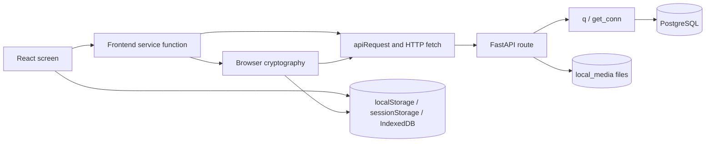

# QUANTX project guide: frontend, backend, and PostgreSQL

This guide describes the code in this repository as of **1 November 2026**. It follows the data from a browser action to a FastAPI route and then to PostgreSQL or local file storage. It is based on the source code, not a dump of your live database. The complete table definitions are in [`schema.sql`](../py_backend/app/schema.sql); the backend runs that schema at startup through [`init_db`](../py_backend/app/db.py).

## The short version



- [`frontend/src/index.js`](../frontend/src/index.js) opens the ordinary app at `/` or the admin page at `/admin`.
- [`App.js`](../frontend/src/App.js) owns account, profile, contact, conversation, group, and channel screen state. [`ChatWindow.jsx`](../frontend/src/components/chatwindow/ChatWindow.jsx) owns the open chat, message actions, and call UI.
- Frontend [`services/`](../frontend/src/services) turn actions into API requests. [`apiRequest`](../frontend/src/services/apiClient.js) adds the bearer token, sends JSON with `fetch`, and handles errors and timeouts.
- [`main.py`](../py_backend/app/main.py) mounts FastAPI routers. A route validates a request, then [`q`](../py_backend/app/db.py) executes parameterized SQL using a PostgreSQL connection pool.
- **Direct message text and direct attachment bytes are encrypted in the browser.** The API stores an encrypted envelope or encrypted file. Group and channel posts do not use this direct-message encryption path.
- There is **no WebSocket service** in this code. The frontend polls for conversations, messages, call signals, and other updates.

## Why Kyber, Dilithium, and AES are used together

Imagine that Alice wants to send Bob a note through a delivery desk. **AES-256-GCM** is the fast lock that seals the actual note with a new random key. **Kyber (ML-KEM-768)** helps Alice package that AES key so Bob can recover it with his private key. **Dilithium (ML-DSA-65)** is Alice's digital signature on the sealed packet, which Bob checks before trusting it. The app also uses **HKDF-SHA256** to derive the wrapping keys from Kyber's shared secret. Bob checks the signature, recovers the AES key, and opens the note in his browser. The delivery desk is the backend: it carries the locked packet and can see routing details, but does not receive the plaintext or raw private keys.

| Job | Common classical example | QUANTX direct-message operation |
| --- | --- | --- |
| Establish a shared secret | RSA key transport or ECDH | ML-KEM-768, derived from Kyber, encapsulates a secret for each reader |
| Prove the sender and detect tampering | RSA or ECDSA signature | ML-DSA-65, derived from Dilithium, signs the encrypted envelope |
| Encrypt the message itself | A symmetric cipher such as AES | A fresh AES-256-GCM content key encrypts each direct message |

A sufficiently capable future quantum computer could undermine RSA and elliptic-curve public-key methods. An attacker might save traffic today and try to decrypt it later. QUANTX uses post-quantum public-key methods for the direct-message path to demonstrate an alternative. AES is still used for the bulk encryption; “post-quantum” here does **not** mean that every part of the app, including password login, groups, calls, or media, is covered by the direct-message protocol. The code has not been independently audited, so these descriptions explain the design rather than promise production security.

## Where the data lives

| Place | What it holds | Lifetime / owner |
| --- | --- | --- |
| React component state | Open chat, composer text, displayed messages, call UI state | Current page session |
| `localStorage` | `pqc_auth_user` (including the user access token), theme choice | This browser origin; survives reload |
| `sessionStorage` | `quantx_admin_session` (admin token and email) | This browser tab/session |
| IndexedDB `quantx-crypto-v2` → `secrets` | User's ML-KEM and ML-DSA private identity, public identity, and contact trust pins | This browser origin; not in PostgreSQL |
| PostgreSQL | Accounts, public identity bundles, conversations, message envelopes, groups, channels, calls, and admin demo metadata | Backend database |
| `LOCAL_MEDIA_ROOT` / `local_media` | Uploaded file bytes. Direct-chat attachment bytes are encrypted before upload; community/profile files are not covered by that direct-message protocol | Backend filesystem |
| Browser tab memory | Optional ten-minute message key walkthrough | Cleared on stop, expiry, reload, or sign-out |

**Origin matters:** `http://localhost:3000` and an ngrok HTTPS URL have different browser storage. A private identity created at one address is unavailable at the other. The public registry currently keeps **one PQC identity row per user**, so signing into the same account on another browser replaces its registered device bundle.

### Using two devices through ngrok

Start PostgreSQL and the Python backend, then run `scripts/start-ngrok.sh` from the repository root. That script checks `/api/health` and `/api/health/db`, builds the React frontend with same-origin `/api` requests, and opens an HTTPS ngrok tunnel to backend port **4000**. The running ngrok process prints the current public URL; it is assigned when the tunnel starts unless `NGROK_URL` is set to a reserved HTTPS address. Open that **same printed URL** on both devices and sign into **different accounts**. There is no permanent URL stored in this repository. A `localhost` address on a second device points to that second device, so it is not the address to share.

Each URL has its own browser IndexedDB. A user's private PQC identity generated at `localhost` does not automatically follow them to the ngrok origin. Changing the tunnel URL can therefore mean new local keys and may make old direct messages unreadable on the new origin. The same account's registered public bundle can also be replaced when it signs in from another browser. For a two-person demonstration, keep each account in its own browser and use one stable HTTPS tunnel URL.

## The 16 PostgreSQL tables

The schema creates **12 active tables** and **4 retained tables from an older E2EE design**. These are *logical* relationships: many IDs are text fields and do not have SQL foreign keys.

| Table | What it stores | Main writers / readers |
| --- | --- | --- |
| `users` | Account ID, unique email, Argon2id `password_hash`, name, phone, lookup variants, contacts, profile URLs, presence timestamps | Auth and user routes; directory, contacts, sidebar, admin |
| `auth_events` | `register`, `login`, and `admin_login` audit event with account ID and time; no passwords or tokens | Auth/admin login writes; admin crypto panel reads |
| `conversations` | One direct-chat row per pair: participants, last-message placeholder/status/time, typing and unread JSONB maps | Direct send/seen/meta routes; sidebar reads |
| `messages` | Direct, group, or channel message row. `body` is JSONB: encrypted envelope for current direct messages, ordinary content for community posts. Also delivery/read/delete flags and edit time | Chat routes; chat screen/admin crypto panel reads |
| `groups` | Group name, description, photo, `member_ids`, `admins`, creator, last-message fields | Community routes; group list/detail screens |
| `channels` | Channel name, description, owner, `follower_ids`, last-post fields | Community routes; channel list/screens |
| `call_logs` | Conversation ID and call details in `data` JSONB, such as type, direction, status, duration, caller and receiver | Call-log route; call history UI |
| `signals` | Temporary WebRTC signaling payloads: offer, answer, ICE candidate, or hangup, plus sender/receiver | Signal routes; call UI polls and deletes consumed rows |
| `crypto_public_identities` | Signed **public** PQC bundle (`bundle` JSONB), suite, user, device, update time | Browser identity registration writes; message send and admin read |
| `crypto_message_receipts` | Client-generated message UUIDs already accepted, including after edits/deletes, to reject reuse | Direct send/edit writes |
| `crypto_demo_sessions` | Which user is being watched by admin and when the ten-minute capture ends | Admin live-demo routes |
| `crypto_demo_events` | Browser-reported step names/status for login, send, receive, or attachment; no key bytes or plaintext | `/api/crypto/activity` writes; admin live-demo reads |
| `user_devices` | **Retained legacy** device public-key fields | Created/migrated by schema; no current route uses it |
| `one_time_prekeys` | **Retained legacy** one-time public prekeys | Created by schema; no current route uses it |
| `e2ee_sessions` | **Retained legacy** session/chain-key fields | Created by schema; no current route uses it |
| `e2ee_replay_index` | **Retained legacy** counter-based replay records | Created/migrated by schema; no current route uses it |

### Important columns and relationships

- `users.uid` is the application user ID. `users.email` has both a normal unique constraint and a unique index on `lower(email)`; nonempty `phone_number` values have a unique index. Pakistani forms such as `03...` and `+923...` are normalized by [`phone_variants`](../py_backend/app/errors.py).
- `users.contacts` is the **viewer's saved contact numbers**. It is not that account's own number. `phone_lookup_keys` contains variants used to find the owner's number.
- A direct conversation ID is the two user IDs sorted and joined by `_`. [`conversationIdFor`](../frontend/src/components/chatwindow/chatFormatters.js) creates it in the frontend; the backend checks it on direct sends.
- `messages.id` is a server-created row UUID. `messages.body->>'message_id'` is a separate client-created protocol UUID. `crypto_message_receipts` remembers protocol UUIDs to reject duplicate envelopes.
- `messages.body` has no fixed SQL columns for the encrypted payload because it is JSONB. It contains fields such as `ciphertext_b64`, `nonce_b64`, `signature_b64`, and `key_wraps` for direct E2EE messages.
- `conversations.last_message` is normally the safe placeholder `[E2EE message]` for a direct message. The browser fetches and decrypts the last message to display a local sidebar preview.
- `call_logs.conversation_id`, `signals.conversation_id`, and many group/channel member IDs are logical references without foreign-key enforcement. Only the admin demo tables and public identity table explicitly reference `users(uid)`.

## Flow 1: registration, login, and local keys

```mermaid
sequenceDiagram
    participant User as User browser
    participant Auth as Frontend authService
    participant API as FastAPI
    participant DB as PostgreSQL
    participant IDB as Browser IndexedDB
    User->>Auth: Submit email + password (+ phone for registration)
    Auth->>API: POST /api/auth/register or /api/auth/login
    API->>DB: INSERT/SELECT users; INSERT auth_events
    API-->>Auth: User data + bearer JWT
    Auth->>IDB: Load or generate ML-KEM / ML-DSA identity
    Auth->>API: POST /api/keys/v2/devices/register (public bundle)
    API->>DB: UPSERT crypto_public_identities
    Auth->>User: Save session in localStorage; open app
```

1. [`App.submitAuth`](../frontend/src/App.js) calls `checkPhoneAvailability` before registration, then custom functions named [`createUserWithEmailAndPassword` / `signInWithEmailAndPassword`](../frontend/src/services/authService.js). **These names are project code, not Firebase functions.**
2. [`/api/auth/register`](../py_backend/app/routes/auth.py) normalizes the email and phone, hashes the password with Argon2id, inserts `users`, and records an `auth_events` row. PostgreSQL's unique indexes are the final email/phone duplicate guard. [`/api/auth/login`](../py_backend/app/routes/auth.py) looks up the user and verifies the Argon2id hash.
3. [`JwtService`](../py_backend/app/security/jwt_service.py) issues an HS256 bearer JWT. [`authenticated_user`](../py_backend/app/security/request_auth.py) checks it on protected routes. Password login itself does **not** use Kyber or Dilithium.
4. [`ensureEncryptionIdentity`](../frontend/src/services/authService.js) loads or generates a browser-held ML-KEM-768 encryption pair and ML-DSA-65 signing pair. [`createIdentityStore`](../frontend/src/crypto/storage/identityStore.js) saves them in IndexedDB. The browser registers only a signed **public** bundle in `crypto_public_identities`.
5. `authService` saves the returned user object and token in `localStorage`, then notifies the UI through its custom `onAuthStateChanged` listener. [`App.js`](../frontend/src/App.js) starts profile and presence polling. Logout marks presence offline, clears the local session and temporary decrypted attachment cache; it does not delete the user's database row or private IndexedDB identity.

The backend returns a `refreshToken` field, but there is no refresh-token endpoint in this repository. After the JWT expires, the user has to sign in again. The frontend can restore an old local session, but the backend will still reject an expired JWT.

## Flow 2: add a contact by phone

`App.addContactByPhone` → [`addContactByPhoneApi`](../frontend/src/services/userService.js) → `POST /api/users/{uid}/contacts` → [`phone_variants`](../py_backend/app/errors.py) → lookup in `users.phone_number` / `phone_lookup_keys` → append the matched account's normalized number to the caller's `users.contacts` array. [`GET /api/thread/users`](../py_backend/app/routes/thread.py) returns people in the caller's contacts or existing direct conversations. A number written only in someone else's `contacts` array does **not** make that person searchable as the owner of the number; they must save it in their own profile.

## Flow 3: send and read a direct message

```mermaid
sequenceDiagram
    participant A as Alice browser
    participant API as FastAPI relay
    participant DB as PostgreSQL
    participant B as Bob browser
    A->>API: GET Bob's public PQC bundle
    API->>DB: SELECT crypto_public_identities
    API-->>A: Signed public bundle
    A->>A: Verify bundle; create AES key; ML-KEM/HKDF wraps; AES encrypt; ML-DSA sign
    A->>API: POST /api/chat/messages/send (envelope only)
    API->>DB: INSERT crypto_message_receipts + messages
    API->>DB: UPSERT conversations; increment unread count
    B->>API: GET /api/chat/messages (poll)
    API->>DB: SELECT messages
    API-->>B: Encrypted envelope
    B->>B: Verify signature; ML-KEM unwrap; AES decrypt
    B->>API: PATCH /api/chat/conversations/seen
    API->>DB: Update read/delivered flags and unread count
```

1. [`ChatWindow.sendMessage`](../frontend/src/components/chatwindow/ChatWindow.jsx) builds the message content. [`sendChatMessage`](../frontend/src/services/chatService.js) turns a direct payload into JSON text and calls [`encryptMessageEnvelope`](../frontend/src/services/e2eeService.js).
2. [`messageEncryption.js`](../frontend/src/crypto/protocol/messageEncryption.js) validates the recipient's signed public bundle and local trust pin. It makes a fresh random 32-byte AES content key. ML-KEM-768 and HKDF-SHA256 create wrapping keys for Bob and separately for Alice's history. AES-256-GCM encrypts the content and ML-DSA-65 signs the envelope. The server does **not** receive plaintext, raw AES content key, or private keys.
3. [`POST /api/chat/messages/send`](../py_backend/app/routes/chat.py) requires a valid user JWT for direct sends, checks the sender/recipient/thread and envelope structure, and checks that the sender's public bundle is registered. It stores the envelope in `messages.body`, records its UUID in `crypto_message_receipts`, and updates the `conversations` summary and unread count. Cryptographic signature verification happens in the receiving browser, not in this route.
4. [`ChatWindow.jsx`](../frontend/src/components/chatwindow/ChatWindow.jsx) polls open-thread messages about every **2 seconds**. [`fetchThreadMessages`](../frontend/src/services/chatService.js) verifies and decrypts direct envelopes locally. Bad or unavailable keys show an error placeholder, not fallback plaintext. The sidebar polls conversation summaries about every **3 seconds** and attempts to decrypt the last-message preview locally.
5. Opening a direct chat calls `markConversationSeen`, updating `messages.read_by`, `messages.delivered_to`, `conversations.last_message_status`, and `conversations.unread_by`. Presence is a separate heartbeat in `users` about every **15 seconds**.

**Direct attachments:** [`uploadEncryptedMedia`](../frontend/src/services/mediaService.js) makes a separate AES-256-GCM file key, encrypts the file in the browser, and uploads ciphertext to local media storage. Its key/nonce descriptor goes **inside** the E2EE message content. The recipient decrypts the message first, then fetches and decrypts the file. The current direct-attachment limit is 15 MB.

## Flow 4: edit, delete, and clear

| User action | Frontend → API | Database effect | What actually remains |
| --- | --- | --- | --- |
| Edit a direct message | `editChatMessage` → `PATCH /api/chat/messages/edit` | Sender creates a **new encrypted envelope**; backend replaces `messages.body`, sets `edited_at`, and records the new protocol UUID | Same server row ID, new ciphertext; old envelope is replaced |
| Edit a group message | Same endpoint | Backend changes `body.text` and `edited_at` | Community text remains server-readable |
| Delete for me | `deleteChatMessageForMe` → `PATCH /api/chat/messages/delete-for-me` | Adds caller's ID to `messages.deleted_for`; GET filters that row for that caller | Row and encrypted body remain for other viewers and in PostgreSQL |
| Delete for everyone | `deleteChatMessageForEveryone` → `PATCH /api/chat/messages/delete-for-everyone` | Sets `deleted_for_everyone`, `deleted_at`, and adds a tombstone `text` field to `body` | Row **and ciphertext/key wraps remain** in PostgreSQL; this is a display deletion, not cryptographic erasure |
| Clear conversation | `clearConversationForUser` → `POST /api/chat/conversations/clear` | Adds one user ID to `deleted_for` for all direct messages in that conversation | Conversation and message rows remain |

The UI checks that the current user is the sender before showing “delete for everyone,” but the current backend delete endpoints do not independently authenticate or enforce sender/participant ownership. See **Current implementation gaps** below.

## Flow 5: groups and channels

[`communityService.js`](../frontend/src/services/communityService.js) calls [`/api/community`](../py_backend/app/routes/community.py) to create groups/channels, change group membership/admins, and follow/unfollow channels. Groups and channels are stored in their own tables. Posts go through `sendChatMessage` and [`/api/chat/messages/send`](../py_backend/app/routes/chat.py) with `thread_type='group'` or `'channel'`; their `messages.body` is ordinary JSON content. The current direct-message PQC flow does **not** protect these posts or their uploaded attachment bytes. Group and channel lists are polled about every **60 seconds**.

## Flow 6: audio/video calls

The call UI is in [`ChatWindow.jsx`](../frontend/src/components/chatwindow/ChatWindow.jsx). It uses browser-built-in `getUserMedia` to ask for microphone/camera access and `RTCPeerConnection` to make a WebRTC peer connection. The Python API is used as a **signaling mailbox**, not as the audio/video media relay:

1. Caller creates a WebRTC offer and `POST`s it to `/api/chat/conversations/signals`; the row is stored in `signals` with `type='offer'`.
2. Recipient polls `/api/chat/signals` about every **1.2 seconds**, receives an offer, creates an answer, and writes another signal. Both peers also exchange ICE candidates through `signals`. Consumed signal rows are deleted.
3. On hangup, the UI sends a `hangup` signal and tries to write a `call_logs` JSONB entry and a call-type chat message. The call history view polls `call_logs` about every **15 seconds**.
4. [`ICE_SERVERS`](../frontend/src/components/chatwindow/chatConstants.js) contains public STUN servers only; no TURN relay is configured. Calls between some networks can fail even if the HTTPS app and signaling API work. Call media, signaling, and logs are outside the app's PQC direct-message protocol.

**Current call-state mismatch:** the frontend sends `{ callState: ... }` to `PATCH /api/chat/conversations/meta`, but the backend route updates only `typing` and `unread_by`; `conversations` has no `call_state` column. The frontend's `selectedCall` therefore cannot be restored from the server, and `acceptCall` requires that state. The backend also returns `call_logs` rows with details nested in `data`, while the display helpers read fields such as `status` at the top level. Treat the call UI as **partially wired**, not a verified end-to-end feature. The underlying offer/answer/ICE storage is present.

## Admin and educational demo

[`AdminPage.jsx`](../frontend/src/pages/AdminPage.jsx) uses a separate admin sign-in at `POST /api/admin/login`. Backend credentials come from environment settings; they are not a row in `users`. The backend issues an admin-scoped JWT and writes an `admin_login` event. Protected [`admin.py`](../py_backend/app/routes/admin.py) routes list/edit users and show public PQC bundles, encrypted message envelopes, and authentication events. Admin profile edits can change name, email, and phone; PostgreSQL uniqueness still applies. Admin views do not receive raw private keys or plaintext.

The **How it works** page has an illustrative animation and a separate real live capture. Admin starts a ten-minute `crypto_demo_sessions` record. A logged-in user's browser sends stage names to `/api/crypto/activity`; valid events go to `crypto_demo_events`. The admin polls those events and can inspect the user's registered public bundle and latest encrypted packet. The user's optional Profile key inspector reads the private keys **locally from that user's browser IndexedDB**, not through an admin API.

**What the key displays mean:** the admin live view prints the complete Base64 public ML-KEM key, public ML-DSA key, public-bundle signature, ciphertext, nonce, wrapped keys, and message signature. It also animates progress reported by the real user's browser. The admin activity table contains step names and status, not raw secrets. On the user's own Profile → Your encryption keys screen, the full private identity keys can be revealed from that browser's IndexedDB. The optional ten-minute local walkthrough can show temporary message key material in that same browser; it lives in tab memory and is not uploaded. A returning user normally reuses existing identity keys at sign-in, so the animation should say “reused” rather than claim that new keys were generated.

## API route map

| Prefix / file | Main purpose | Authentication in current route code |
| --- | --- | --- |
| [`/api/auth`](../py_backend/app/routes/auth.py) | Register, login, profile update | Register/login public; profile update user JWT |
| [`/api/users`](../py_backend/app/routes/users.py) | Phone lookup, profile, presence, contacts | Phone availability public; most profile/contact routes user JWT |
| [`/api/thread`](../py_backend/app/routes/thread.py) | User/contact list, conversations, groups, channels, delivery | Only `/users` uses user JWT; others currently use supplied IDs or are public |
| [`/api/chat`](../py_backend/app/routes/chat.py) | Message send/read/edit/delete, read status, call logs/signals, conversation metadata | Direct send/read/edit use user JWT; several delete, metadata, call, and signal routes do not |
| [`/api/keys/v2`](../py_backend/app/routes/crypto_keys.py) | Public PQC identity registration and lookup | User JWT |
| [`/api/crypto`](../py_backend/app/routes/crypto_activity.py) | Metadata-only live-demo events | User JWT |
| [`/api/community`](../py_backend/app/routes/community.py) | Groups, channels, membership, follows | No user JWT dependency in current file |
| [`/api/media`](../py_backend/app/routes/media.py) | Local file upload/read/delete | No user JWT dependency in current file |
| [`/api/admin`](../py_backend/app/routes/admin.py) | Admin login, directory, edits, crypto records/live demo | Login public; remaining routes admin JWT |
| [`/api/keys`](../py_backend/app/routes/keys.py) | Retired older key API | Returns retired-protocol response |

FastAPI also serves `/api/health`, `/api/health/db`, and the built React site from [`main.py`](../py_backend/app/main.py). It exposes generated interactive API documentation at `/docs` when the backend runs.

## Built-in/library features versus project functions

| Source | Provided feature | Project code that uses it |
| --- | --- | --- |
| React library | `useState`, `useEffect`, `useMemo`, `useRef`, component rendering | `App`, `ChatWindow`, admin and profile pages |
| Browser platform | `fetch`, `localStorage`, `sessionStorage`, IndexedDB, `setInterval`, `crypto.getRandomValues`, Web Crypto `crypto.subtle`, `getUserMedia`, `RTCPeerConnection` | API transport, sessions, local identity store, polling, AES/HKDF, calls |
| `@noble/post-quantum` | ML-KEM-768 and ML-DSA-65 implementations | [`postQuantum.js`](../frontend/src/crypto/providers/postQuantum.js) wraps keygen, encapsulation, signing, verification |
| FastAPI / Pydantic | HTTP routing, dependency injection, request models and validation | Routers and [`e2ee.py`](../py_backend/app/schemas/e2ee.py) |
| `psycopg2`, `passlib`, `python-jose` | PostgreSQL driver/pool, Argon2 hashing, JWT encode/decode | [`db.py`](../py_backend/app/db.py), [`passwords.py`](../py_backend/app/security/passwords.py), [`jwt_service.py`](../py_backend/app/security/jwt_service.py) |
| PostgreSQL | `now()`, `uuid_generate_v4()`, JSONB operators, `jsonb_set`, `array_append`, unique indexes | SQL in schema and route files |
| **Project-written** | `apiRequest`, `phone_variants`, `q`, `authenticated_user`, `conversationIdFor`, `sendChatMessage`, `fetchThreadMessages`, `createMessageEncryption`, `deriveWrappingKey`, `seal`, `open`, `beginPqcActivity`, `startCall`, `deleteForMe` | Glue and application rules implemented in this repository |

### Project function directory

This is the index of the main project-written functions. The linked files contain their parameters and smaller UI helpers.

| Project file | Main custom functions | What they control |
| --- | --- | --- |
| [`App.js`](../frontend/src/App.js) | `submitAuth`, `addContactByPhone`, `handleCreateGroup`, `handleCreateChannel`, `savePhoneNumber`, `logout` | Top-level UI actions and refresh effects |
| [`authService.js`](../frontend/src/services/authService.js) | `onAuthStateChanged`, `ensureEncryptionIdentity`, `createUserWithEmailAndPassword`, `signInWithEmailAndPassword`, `updateProfile`, `signOut` | Local session and identity registration |
| [`userService.js`](../frontend/src/services/userService.js) | `checkPhoneAvailability`, `fetchUserProfile`, `updateMyPhoneNumber`, `setPresence`, `updateUserProfile`, `addContactByPhoneApi` | User/profile API requests |
| [`threadService.js`](../frontend/src/services/threadService.js) | `fetchUsers`, `fetchConversations`, `markDelivered`, `fetchGroups`, `fetchChannels`, `hydrateConversationPreviews` | Sidebar lists and decrypted previews |
| [`chatService.js`](../frontend/src/services/chatService.js) | `sendChatMessage`, `editChatMessage`, `deleteChatMessageForMe`, `deleteChatMessageForEveryone`, `fetchThreadMessages`, `markConversationSeen`, `fetchCallLogs`, `fetchSignals`, `addConversationSignal`, `clearConversationForUser` | Message encryption handoff, transport, and call API requests |
| [`ChatWindow.jsx`](../frontend/src/components/chatwindow/ChatWindow.jsx) | `sendMessage`, `editMessage`, `deleteForMe`, `deleteForEveryone`, `startCall`, `acceptCall`, `endCall`, `sendCallSignal`, `saveCallLogAndMessage` | Actions inside the open conversation |
| [`mediaService.js`](../frontend/src/services/mediaService.js) | `uploadMedia`, `uploadEncryptedMedia`, `resolveEncryptedMedia`, `clearDecryptedAttachments` | File upload and browser-side direct-file decryption |
| [`communityService.js`](../frontend/src/services/communityService.js) | `createGroup`, `leaveGroupApi`, `addGroupMemberApi`, `removeGroupMemberApi`, `toggleGroupAdminApi`, `createChannel`, `followChannel`, `unfollowChannel` | Group/channel requests |
| [`adminService.js`](../frontend/src/services/adminService.js) | `signInAdmin`, `fetchAdminUsers`, `updateAdminUser`, `fetchAdminCryptoOverview`, `fetchAdminCryptoItems`, `startAdminLiveDemo`, `stopAdminLiveDemo`, `fetchAdminLiveDemo` | Admin requests |
| [`messageEncryption.js`](../frontend/src/crypto/protocol/messageEncryption.js) | `createMessageEncryption` returning `register`, `encrypt`, `decrypt`, `safetyNumber`, `trustContact` | Direct-message PQC protocol |
| [`symmetric.js`](../frontend/src/crypto/primitives/symmetric.js) and [`attachmentEncryption.js`](../frontend/src/crypto/protocol/attachmentEncryption.js) | `deriveWrappingKey`, `seal`, `open`, `encryptAttachment`, `decryptAttachment` | HKDF/AES operations and direct files |
| [`db.py`](../py_backend/app/db.py) and [`request_auth.py`](../py_backend/app/security/request_auth.py) | `get_conn`, `q`, `init_db`, `db_healthcheck`, `authenticated_user` | SQL connection/queries and bearer-token checks |
| [`auth.py`](../py_backend/app/routes/auth.py), [`users.py`](../py_backend/app/routes/users.py), [`thread.py`](../py_backend/app/routes/thread.py) | `register`, `login`, `update_profile`, `add_contact`, `update_my_phone`, `set_presence`, `conv`, `groups`, `channels` | Account, contact, and list HTTP handlers |
| [`chat.py`](../py_backend/app/routes/chat.py) | `send`, `edit`, `delme`, `delall`, `list_messages`, `seen`, `addlog`, `addsig`, `clear` | Message, deletion, status, and call HTTP handlers |
| [`crypto_keys.py`](../py_backend/app/routes/crypto_keys.py), [`crypto_activity.py`](../py_backend/app/routes/crypto_activity.py), [`admin.py`](../py_backend/app/routes/admin.py) | `register`, `bundle`, `record_activity`, `list_users`, `update_user`, `crypto_messages`, `start_live_demo`, `get_live_demo` | Public-key registry and admin displays |

For example, `crypto.subtle.encrypt` is a browser API, while this project's [`seal`](../frontend/src/crypto/primitives/symmetric.js) chooses AES-GCM, creates a fresh nonce, passes authenticated data, and returns the app's `{ nonce, ciphertext }` shape. `ml_kem768.encapsulate` is from a package; this project's [`encrypt`](../frontend/src/crypto/protocol/messageEncryption.js) decides when to use it, how to derive a wrapping key, what to sign, and how to package the result. `createUserWithEmailAndPassword` and `onAuthStateChanged` are **custom functions in `authService.js`**, despite their familiar names.

## Current implementation gaps to know about

These are observations from source code, not a live security test:

1. **Call state is incomplete:** `callState` sent by the frontend is ignored by `/api/chat/conversations/meta`, and the database has no matching column. Call-log JSON shape also differs between API and UI. WebRTC signaling code exists, but full calls are not confirmed by the current code path.
2. **Deletion is a flag:** “delete for everyone” leaves the encrypted envelope in `messages.body`; “delete for me” and clear hide rows for a user. These actions are not physical database erasure.
3. **Several routes trust client-supplied IDs:** message deletion/flags, call signals/logs, conversation metadata, parts of `/api/thread`, `/api/community`, and `/api/media` lack a user-JWT dependency. Do not treat a frontend button restriction as server authorization.
4. **Community features have route/shape gaps:** `communityService.updateGroupProfileApi` calls `PATCH /api/community/groups/{id}/profile`, but that backend route is absent. Group/channel list routes return SQL field names such as `member_ids` and `follower_ids`, while several UI components expect `memberIds` and `followerIds`.
5. **One public PQC device per account:** `crypto_public_identities` has primary key `(user_id, suite_id)`, so another browser for the same account overwrites the registered bundle. Existing messages remain tied to the original device's private key.
6. **Session refresh is missing:** a `refreshToken` is returned at login but no refresh endpoint consumes it. Expired bearer JWTs require a new sign-in.

## Read-only PostgreSQL inspection

Connect using the host, user, and database configured in `py_backend/.env`. Let `psql` prompt for the password; do not put the password in this document or in a shell history command.

```bash
psql -h localhost -U postgres -d quantx_db
```

Inside `psql`:

```sql
\dt
\d users
\d messages

SELECT uid, email, phone_number, created_at FROM users ORDER BY created_at DESC LIMIT 20;
SELECT account_id, event_type, created_at FROM auth_events ORDER BY created_at DESC LIMIT 20;
SELECT id, participants, last_message, last_message_status, unread_by
FROM conversations ORDER BY last_message_at DESC NULLS LAST LIMIT 20;
SELECT id, thread_type, thread_id, sender_id, receiver_id, created_at,
       body->>'type' AS body_type, body->>'suite_id' AS suite,
       deleted_for, deleted_for_everyone
FROM messages ORDER BY created_at DESC LIMIT 20;
SELECT user_id, suite_id, device_id, updated_at
FROM crypto_public_identities ORDER BY updated_at DESC LIMIT 20;
SELECT conversation_id, data->>'type' AS call_type,
       data->>'status' AS call_status, created_at
FROM call_logs ORDER BY created_at DESC LIMIT 20;
SELECT conversation_id, type, sender, receiver, created_at
FROM signals ORDER BY created_at DESC LIMIT 20;
```

These queries show structure and metadata without printing password hashes or complete key material. The database may include rows or schema changes from earlier versions; `\d table_name` shows what is actually present in your running database.

